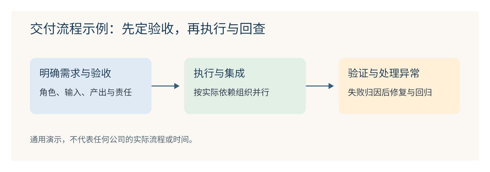

# design-lark-chart

从真实材料快速制作可编辑飞书画板：产研流程、串并行协作、大小需求时间线、个人时间与工具、组织架构及辅助矩阵。保留原 skill 的分类、规划、风格参数与检查脚本，补齐通用操作与报告视觉技巧。



## 安装一个 skill

```bash
npx skills add https://github.com/chengjialu8888/design_lark_chart --skill design-lark-chart
```

也可以把仓库链接交给 Agent：“请安装此仓库的 design-lark-chart skill，先运行环境预检，再根据我的材料画图。”

手工安装：克隆整个仓库到 Agent 的 `skills/design-lark-chart/`；不要只复制 SKILL.md。Codex 示例：

```bash
git clone https://github.com/chengjialu8888/design_lark_chart.git ~/.codex/skills/design-lark-chart
python3 ~/.codex/skills/design-lark-chart/scripts/preflight.py
```

目录已存在时先检查更新，不能覆盖用户修改。Claude Code 等宿主按其当前 skills 目录规则安装。

## 工具与授权

- Node.js ≥20，npm／npx；Python ≥3.10 用于自带检查脚本，Bash 用于旧版包装脚本。Windows 可用 WSL 跑这些脚本。
- 飞书官方 CLI 安装、登录与权限配置：[larksuite/cli](https://github.com/larksuite/cli)。
- 画板转换工具：[@larksuite/whiteboard-cli](https://www.npmjs.com/package/@larksuite/whiteboard-cli)，按 references/setup.md 使用兼容版本。
- 能查看 PNG／截图的 Agent；浏览器预览是可替代项。无需 Office、PPT 引擎、图片生成 API 或本仓库作者的飞书权限。

只安装 skill 不等于完成运行时安装或授权；预检会分别报告。无需另装 beautiful-feishu-whiteboard 或 Mck skill 才能使用本包；需要完整色板库或 PPT 能力再安装上游。

## 使用示例

> 根据附件访谈绘制产研开发主流程：先需求来源和异步优先级评审，再按大小需求与依赖分支，标岗位、人数、阶段耗时、交接、验收、返修与上线观察。未知项写待补。重点流程用浅蓝／浅绿／橙色，辅助图用结构化简洁卡片。保留原文档其他内容，先检查现有画板，再原位更新并回查。

> 把个人工作安排与工具串起来。有可靠时长才画分配条；只有活动描述就用定性日程卡，不能凑百分比。

## 可复刻的检查

```bash
python3 scripts/preflight.py
python3 scripts/preflight.py --online --output /tmp/design-preflight.json
python3 scripts/smoke_test.py --output /tmp/design-chart-smoke
```

预检不安装、不登录、不写飞书；online 模式会检查已配置的授权与渲染器。smoke test 只做本地 SVG 检查、转换和导出，不创建云文档。云端写入与视觉复核须在用户授权的任务中完成，不能从本地测试推导成功。

## 内容结构

- `SKILL.md`：Agent 入口与按需路由。
- `references/`：原技能图型规划与质量门，新增环境、飞书操作、兼容技巧、报告视觉。
- `assets/style-tokens/`：去除租户定位信息的图型样式参数。
- `scripts/`：预检、本地冒烟及原有检查器。
- `examples/`：不含真实业务材料的示例 SVG。

公开版不包含租户原始画板、业务访谈、授权配置与内部报告链接。来源与权利范围见 [NOTICE.md](NOTICE.md)。
