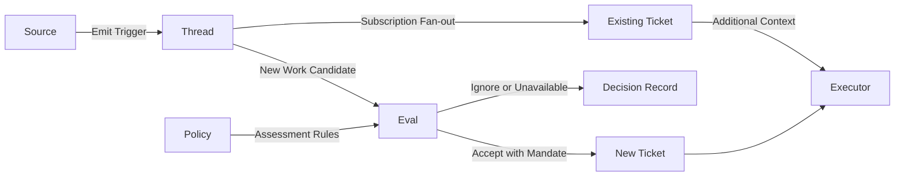
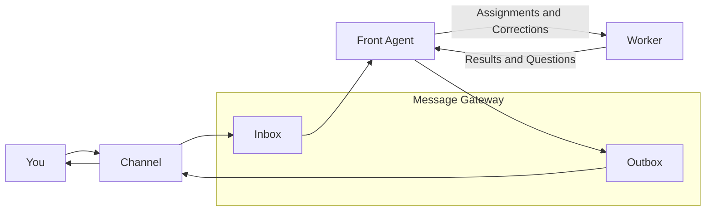
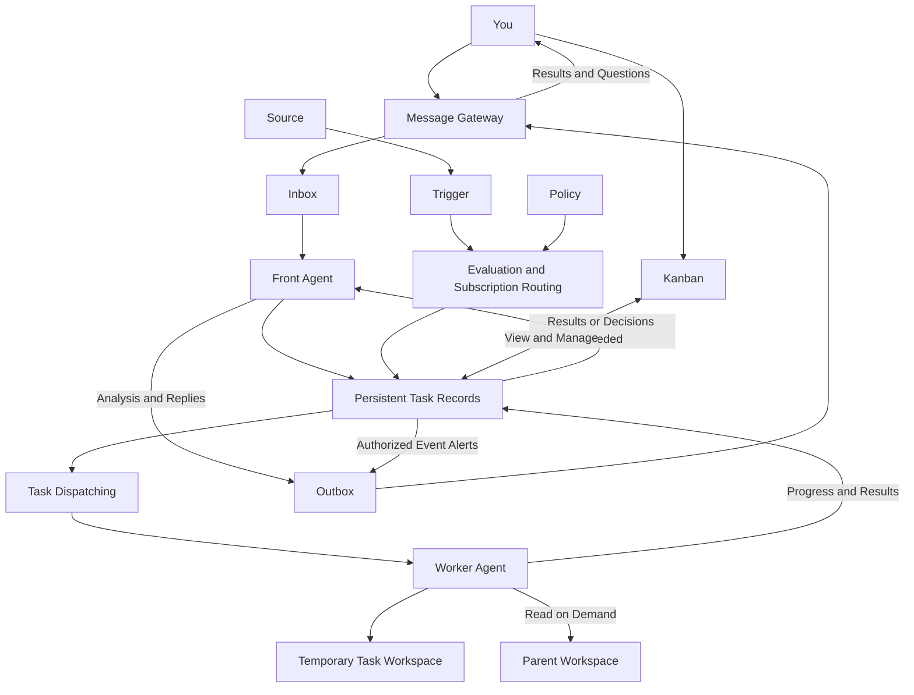

# 原始提示词样例（来自 aigc-prompts.zip）

用户最初提供的提示词集，用于参考英文提示词写法、约束措辞和版式描述。复用时只借鉴结构与约束，不照抄其中的节点和文字。

## 目录
- domain-event-flow-crayon
- human-in-on-loop-crayon
- human-in-on-out-loop-crayon
- kanban-crayon
- message-gateway-crayon
- monitoring-research-crayon
- personal-agent-architecture-crayon
- personal-agents-pixel-hero-v1
- source-alert-research-crayon

## domain-event-flow-crayon

对应 Mermaid 源：



```text
Generator: built-in image_gen

Use case: style-transfer / infographic-diagram. Redraw the supplied technical diagram for a Chinese technical blog, with all labels in English. Pure WHITE background, hand-drawn dark graphite/crayon outlines and arrows, pale blue crayon shaded rounded rectangles, clearly HANDWRITTEN lettering with natural slight irregularity (not typeset). Restrained warm orange accent. Clean, friendly editorial sketch, visible wax-pencil grain inside shapes, no paper tint, no shadows, no decorations, no watermark. Large legible labels, generous whitespace. Compact almost-square composition suitable for a phone screen. Preserve all specified graph connections exactly; use clear arrowheads, no ambiguous crossings.
Input image is the content reference. Reflow its ultra-wide graph into a readable portrait or nearly square chart with two branches, NOT a single pipeline. Keep the exact English labels, which may wrap over 2 lines. At top: Source → Thread with arrow label "Emit Trigger". From Thread branch left to Existing Ticket with label "Subscription Fan-out"; this branch continues toward Executor with edge label "Additional Context". From Thread branch right to Eval with label "New Work Candidate". Place Policy beside Eval as a separate input: Policy → Eval labelled "Assessment Rules". Eval has TWO outputs: toward New Ticket labelled "Accept with Mandate", and toward Decision Record labelled "Ignore or Unavailable". New Ticket → Executor. Existing Ticket and New Ticket converge at ONE shared Executor near bottom. Decision Record is a terminal node on the right. Draw Existing Ticket route in pale blue, new work/Eval route in soft green with light orange for Decision Record; all nodes retain hand-crayon texture and dark handwritten lettering. Exactly 8 nodes: Source, Thread, Existing Ticket, Policy, Eval, New Ticket, Decision Record, Executor. Labels belong beside the correct arrows; do not place a label on a different route. No title, no prose, no extra arrows, no icon needed.

```

## human-in-on-loop-crayon

```text
Generator: built-in image_gen
Reference: user-provided Human in/on the Loop diagram

Use case: style-transfer / infographic-diagram.
Redraw the attached technical diagram as a polished hand-drawn crayon illustration for a Chinese technical blog, optimized for reading on a mobile phone. Input image is the semantic reference/edit target; preserve the exact workflow relationships and labels but completely redesign the layout.
Canvas: portrait 3:4 aspect ratio, about 1200 x 1600, pure white background (#FFFFFF), generous margins. Two clearly separated panels stacked TOP and BOTTOM, not side by side. Top: Human in the Loop. Bottom: Human on the Loop. No overall title needed. White panel interiors, lightly drawn crayon outlines, subtly rounded rectangles, soft restrained peach for top, sage green/light blue for bottom, amber for waiting, dark charcoal text. Visible wax-crayon strokes in borders and small fill patches; sophisticated friendly sketchbook technical illustration, not childish. No paper-colored background, no gradients, no 3D, no decorations that compete with arrows. Very large extremely legible Chinese labels; neat upright hand-lettered appearance, accurate Simplified Chinese. English headings bold and large, keep exactly as written.
TOP PANEL exact title: "Human in the Loop". Main flow across panel: "完成分析" -> "等待批准" -> "执行升级". Below the center waiting box, a small simple hand-drawn person icon labeled "你", with a single upward arrow from person to "等待批准". Thus human approval lies in the main path. No other nodes or arrows in top panel.
BOTTOM PANEL exact title: "Human on the Loop". Main flow across panel: "发现更新" -> "分析与测试" -> "提交结果". Below main row, ample space for two nodes: "等待决定" on the left and person icon labeled "你" on right. A dashed amber arrow from "分析与测试" down-left to "等待决定" labeled exactly "超出授权". A solid arrow from "等待决定" to "你". A dashed blue curved arrow from "你" going back UP to "分析与测试", labeled exactly "查看与干预". Route paths so they never cross text, and make every arrowhead's direction unmistakable. The human supervises from outside normal execution and is consulted when scope is exceeded. Keep normal path clear and dominant.
No added explanatory paragraphs, no watermark, no duplicated labels, no invented steps. Large labels on short arrows must remain readable at phone width. Preserve all relationships faithfully; whitespace and clarity are more important than ornament.

```

## human-in-on-out-loop-crayon

```text
Generator: built-in image_gen
Reference: user-provided three-loop conceptual diagram

Use case: style-transfer / infographic-diagram.
Redraw the attached reference as an extremely simple conceptual infographic, not a detailed process flowchart. Preserve its core idea: the position of the human relative to an AI action loop distinguishes three modes. Correct the reference typo "Human-on-on-the-Loop".
Style: pure white background, hand-drawn pencil/crayon outlines, subtle colored wax strokes, clean and restrained. Friendly simple human silhouette, no detailed cartoon face. Dark charcoal arrows, blue AI circles, warm orange human icons. No panel boxes, no explanatory paragraphs, no decorative doodles.
Composition: portrait 2:3 canvas, three equally sized rows stacked vertically for mobile reading, airy but compact. Each row has its English heading centered above a large simple loop. Thin pale sketch separators between rows only if needed. Very large readable labels and icons. All three loops same size and structure, making the human position the visual focus.
Row 1 exact heading "Human in the Loop". Show a cycle that MUST pass through a human before action: blue circle labeled "AI" at left, human silhouette labeled "人" at lower center, simple action node labeled "执行" at right. Clear solid directed arrows AI -> human -> action -> AI, curved into one circular or oval loop. Human is an integral checkpoint ON the solid action path.
Row 2 exact heading "Human on the Loop". Show an uninterrupted solid circular loop AI -> 执行 -> AI using blue AI circle on left and action on right. Human silhouette labeled "人" is positioned just OUTSIDE the loop, above or to the side, linked by a single dashed two-way line to the loop representing supervision and intervention. The solid normal execution path never passes through the human.
Row 3 exact heading "Human out of the Loop". Same solid AI -> 执行 -> AI loop, absolutely NO human icon or human label and NO dashed supervision connector.
Only permitted text: the three exact English headings, "AI", "人", "执行". No subtitles, no legend, no extra words or numbers. The text explanation will be in the article, not the image. Ensure no arrows are hidden behind labels, and the three semantic differences can be understood at a glance. Hand-drawn crayon texture but precise conceptual clarity. Avoid photorealism, shadows, gradients, colored background, excessive roughness.

```

## kanban-crayon

```text
Generator: built-in image_gen
Use case: infographic-diagram
Create a finished Chinese technical blog illustration explaining a personal agent Kanban. White background, portrait 2:3, ideally 1024x1536 or higher. Charming restrained wax crayon drawing, hand-drawn outlines and VERY LEGIBLE handwritten Chinese lettering. Soft blue, amber, mint, lavender crayon fills, dark charcoal text. Clean editorial diagram, not photorealism. Large text readable on mobile, abundant white space. No drop shadows, no dark background, no decoration unrelated to content.

This is a SNAPSHOT of different tasks, NOT a sequential workflow. DO NOT draw arrows between status groups. Compose:
Top heading exactly "多项任务，一眼看清"
Small subtitle "同一时刻 · 不同状态"
Main board: TWO columns and THREE rows of clearly separated pale crayon colored status regions. Inside each region, one or two white paper task cards. Equal widths. Hand-drawn simple icons beside headings. These exact texts:
Top left status "排队" and single card "升级兼容性测试"
Top right status "执行中" and single card with title "BABA 下跌研究" and smaller second line "关联主任务：BABA 监控"
Middle left status "等待事件" and two little cards "其他价格关注" and "依赖版本跟踪"
Middle right status "等待你" and card title "确认破坏性变更" and smaller line "需要你的决定"
Bottom left status "待验收" and card "升级 PR"
Bottom right status "已完成" and card "上一版影响报告"

Below board, separated by generous whitespace, show ONE expanded master task card spanning width, title "展开主任务：BABA 监控". Inside exactly three concise horizontal rows, with simple icons:
green check "跌破条件已命中"
green check "快讯已送达"
blue spinner or clock "等待研究与分析交付"
This card is an expanded detail example, not another column and not a completion of the entire delegation. Make the working BABA research card and this parent task detail share a subtle blue accent or tiny matching link icon, NO long crossing connector.

At very bottom a friendly hand-drawn small person with label "You", next to three outlined small action buttons labeled "补充要求" "调整优先级" "停止任务". These are actions available on task cards. No giant callouts, no extra paragraphs. This is our own proposed personal agent board, NOT a recreation or screenshot of DeepSeek Panel. Do not include DeepSeek logos or product names. No English other than BABA, PR, You; no numbering. Exact Chinese text, comfortable visual hierarchy, not dense.

```

## message-gateway-crayon

对应 Mermaid 源：



```text
Generator: built-in image_gen

Use case: style-transfer / infographic-diagram. Redraw the supplied technical diagram for a Chinese technical blog, with all labels in English. Pure WHITE background, hand-drawn dark graphite/crayon outlines and arrows, pale blue crayon shaded rounded rectangles, clearly HANDWRITTEN lettering with natural slight irregularity (not typeset). Restrained warm orange accent. Clean, friendly editorial sketch, visible wax-pencil grain inside shapes, no paper tint, no shadows, no decorations, no watermark. Large legible labels, generous whitespace. Compact almost-square composition suitable for a phone screen. Preserve all specified graph connections exactly; use clear arrowheads, no ambiguous crossings.
Input image is the content reference. Nodes: You, Channel, Inbox, Outbox, Front Agent, Worker. Draw a small friendly orange stick-person beside the handwritten word "You". Enclose ONLY Inbox and Outbox in a large hand-sketched rounded container labelled "Message Gateway".
Suggested arrangement: You and Channel at the top, Gateway below containing Inbox left and Outbox right, Front Agent below the gateway, Worker at bottom. Connections: You → Channel and Channel → You as two separate directional arrows; Channel → Inbox; Inbox → Front Agent; Front Agent → Outbox; Outbox → Channel. Front Agent → Worker labelled "Assignments and Corrections"; Worker → Front Agent labelled "Results and Questions". Use two well-separated curved parallel lanes for those opposite directions and wrap each label over two lines. No arrows directly from Worker to Gateway. No extra title or explanatory prose. All text must be spelled exactly as provided.

```

## monitoring-research-crayon

```text
Generator: built-in image_gen
Create a simple vertical illustrated process for a Chinese technical blog, pure WHITE background, large HANDWRITTEN Chinese and English, colored wax CRAYON outlines and pale crayon fill, matching reference style only. Portrait 2:3, phone readable, five spacious stacked rounded cards with simple downward arrows, NOT a sequence diagram. Minimal text, no swimlanes, no tiny text. Small friendly orange person at top beside speech bubble exact text "阿里跌破 100 时，告诉我最新市场综合判断". Then five cards, each a small sketch icon and exactly these title and subtitle:
1 title "建立关注" subtitle "监控 Ticket · Subscription" (clipboard icon)
2 title "等待行情" subtitle "Source 检测 BABA < $100" and one short note "仅约定交易时段" (price line icon)
3 title "先发快讯" subtitle "Outbox 入队，随后推动研究" (bell icon)
4 title "评估接单" subtitle "Eval + Policy → 研究 Ticket" and short note "接受后才开始研究" (checklist icon)
5 title "研究并交付" subtitle "Executor · Ticket 独立目录" and short text "下跌原因 · 市场行情 · 多空情绪" (report icon).
Below final card a short arrow to a message bubble "Outbox → You" with little person.
Between cards 2 and 3 label arrow "Trigger". Between cards 4 and 5 label arrow "Assignment". Other arrows unlabelled.
Footer small but readable "本文扩展示例 · 快讯投递与研究独立推进".
Blue cards 1/2, orange card 3, green cards 4/5. Dark graphite handwritten lettering, no printed font, no extra technical components, no decorative title. Preserve whitespace and few words.

```

## personal-agent-architecture-crayon

对应 Mermaid 源：



```text
Generator: built-in image_gen

Use case: infographic-diagram / style-transfer.
Create a NEW complete Personal Agent architecture diagram for a technical blog. The reference image is STYLE ONLY: match its pure white background, genuinely handwritten English lettering, graphite/crayon outlines, pale blue/green/orange wax-crayon fills, slightly irregular rounded boxes and curved arrows. Do NOT copy its graph or labels. No printed fonts. Phone-readable PORTRAIT composition, approximately 3:4, high resolution, spacious labels that wrap cleanly. No title, no legend, no decorative prose. Small orange stick-person beside "You".

This new diagram connects messaging, subscriptions, and persistent task management. Preserve the following directed graph exactly. Each named node appears ONCE. Use large legible lettering. Nodes:
You; Message Gateway; Inbox; Front Agent; Source; Trigger; Evaluation and Subscription Routing; Policy; Persistent Task Records; Task Dispatching; Worker Agent; Outbox; Temporary Task Workspace; Parent Workspace; Kanban.

Edges:
You → Message Gateway.
Message Gateway → You labelled "Results and Questions".
Message Gateway → Inbox.
Inbox → Front Agent.
Source → Trigger.
Trigger → Evaluation and Subscription Routing.
Policy → Evaluation and Subscription Routing.
Front Agent → Persistent Task Records.
Evaluation and Subscription Routing → Persistent Task Records.
Persistent Task Records → Task Dispatching.
Task Dispatching → Worker Agent.
Worker Agent → Persistent Task Records labelled "Progress and Results".
Persistent Task Records → Front Agent labelled "Results or Decisions Needed".
Front Agent → Outbox labelled "Analysis and Replies".
Persistent Task Records → Outbox labelled "Authorized Event Alerts".
Outbox → Message Gateway.
Worker Agent → Temporary Task Workspace.
Worker Agent → Parent Workspace labelled "Read on Demand".
Kanban ↔ Persistent Task Records labelled "View and Manage".
You → Kanban.

Layout guidance: central vertical spine Message Gateway, Inbox, Front Agent, Persistent Task Records, Task Dispatching, Worker Agent, with workspaces at bottom. Put You upper left; Kanban in left margin around Task Records, with a clean outer left route from You. Put Outbox upper/right of Front Agent and connect a clean return route to Gateway. Put Source → Trigger → Evaluation and Subscription Routing in a right-side vertical lane, with Policy adjacent to Routing, converging into Task Records. Let the Source lane begin lower than Outbox to avoid conflict. Route return arrows alongside their forward arrows as separate visible curves. Task Records should be the central visually prominent orange node, Kanban orange, messaging nodes blue, event/routing nodes green, workspaces pale blue. Reserve clear lanes for Task Records → Outbox fast alert path and Worker → Task Records progress path. Avoid arrow crossings wherever possible; no line through text or nodes. The 2 workspaces at bottom must be distinctly separate; no arrow between them. No spurious arrows. EVERY graph connection above must be visible with correct arrowhead. Handwritten text can wrap into 2 or 3 lines for long labels. White background, no cream tint or shadows.

```

## personal-agents-pixel-hero-v1

```text
Generation: built-in image_gen. Final export: 2145 x 429 (5:1), cropped without resampling from revised generated art.
Reference sources:
Dots Alfred: https://www.bright.nl/nieuws/2141346/ai-werd-iets-te-eng-daarom-komt-openai-met-schattige-ai-agents-dots.html
Muse Jolly: https://research.meta.ai/blog/bringing-your-muse-to-life
Grok Bot official mark: https://x.ai/news/introducing-grok-bot

Initial prompt:
Create an original editorial hero poster for a Chinese technical blog about proactive personal AI agents. EXACT ultra-wide aspect ratio 5:1, target 3200 x 640 pixels, edge-to-edge artwork, no letterboxing or blank bands. The supplied three images are CHARACTER REFERENCES ONLY, not layouts to reproduce.
Reference 1: OpenAI Dots Alfred, a bright yellow rounded triangular blob, oversized thin black circular spectacles and a black bow tie. Ignore photograph background and human.
Reference 2: Meta Muse Jolly, friendly ivory/white furry rounded creature, tiny black eyes, simple smiling mouth, stubby arms and feet.
Reference 3: Grok Bot official mark: a simple round white blob with two parallel diagonally tilted blue capsule eyes. Transform this exact shape into an expressive pixel mascot, not the Grok anime companion or a generic robot.
Art direction: premium pop-art poster meets early Nintendo Famicom / Super Nintendo 16-bit sprite art. Crisp intentional square pixels, limited color ramp shading, stepped silhouettes, pixelated Ben-Day halftone fields, electric cobalt, hot coral-red, bright lemon yellow, turquoise and ivory, deep navy outlines. Cheerful clever personality, strong graphic impact, sophisticated editorial composition, not a screenshot or corporate dashboard.
Composition: one continuous panoramic game-world with 3 interlocking bold color zones, not separate boxed portraits. All three characters large, instantly legible, fully within the shallow 5:1 frame. Alfred on the left is watching a tiny pixel stock chart and catching a bell alert; Jolly in the center sends a flying envelope/flash bulletin and coordinates; the round Grok Bot on the right investigates at a small computer alongside research documents and a magnifier. Small pixel envelopes, task cards and dotted paths connect the activities to suggest autonomous collaboration and background work. Miniature arcade platforms, stairs, clouds and sparkle tiles give a playful 1990s Nintendo game-poster energy. Keep props economical; characters dominate. The mascots can have small sprite limbs as artistic adaptations, retain their distinguishing identities.
No giant headline, no long words, no product UI, no invented brand logos, no Nintendo logo, no extra famous game characters, no photorealism, no 3D rendering, no blur, no gradients except pixel dithering, no watermark. Leave breathing room around each character. Final image itself must be a wide 5:1 banner, not a banner sitting inside a taller canvas.

Revision: Recompose for a shallow panoramic banner. Retain characters and style; reduce sky and lower cliffs; keep faces and accessories. Requested 5:1; generator returned a taller file with white bands, so final delivery is a 5:1 crop of the artwork.


```

## source-alert-research-crayon

```text
Generator: built-in image_gen
Use case: infographic-diagram. Create a very simple portrait 2:3 Chinese technical-blog diagram on pure white, wax-crayon fills, dark hand-drawn outlines, large highly legible handwritten lettering, matching the attached reference STYLE ONLY. Do NOT reuse its complex topology. Mobile-first; lots of whitespace, minimal words, 4 main cards down the page.

Title exactly "先发快讯，再做研究".
Four main rounded cards stacked vertically, occupying the left/center 70% of the width:
1 pale blue: heading "Source 监控", two short lines "交易时段 · BABA < $100" and "等待时，模型不运行". A tiny price-chart icon.
Down arrow labeled "条件命中".
2 pale orange: heading "快讯入 Outbox", short message "已跌破，分析稍后". From this card a SHORT orange right arrow to a small hand-drawn person holding a phone, label "You". Arrow label "发送". This rightward delivery branch must NOT connect to the research step.
From card 2 a separate DOWN arrow to card 3, label "入队即启动". This means research starts upon queueing, not upon notification delivery.
3 pale green: heading "Executor Agent", subheading "临时深度研究"; only two short lines below "独立 Workspace" and "复用主任务资料". Tiny magnifier and folder icon.
Down arrow to card 4.
4 pale blue: heading "Main Agent → Outbox", two short lines "原因 · 行情 · 多空" and "交付分析". Short blue right arrow to another small drawing of the same person holding a phone labeled "You".

No other boxes, no swim lanes, no return arrows, no database nodes, no extra title or subtitles, no invented details. Flow must be unambiguous. 4 boxes and 2 small recipient icons maximum. Main spine vertical, delivery branches short. English terms exactly Source, BABA, Outbox, Executor Agent, Workspace, Main Agent, You. Do NOT use Front Agent or Worker Agent. The condition is a simplified threshold example; do not invent real market prices or data. Keep each requested text exact and large.

```

