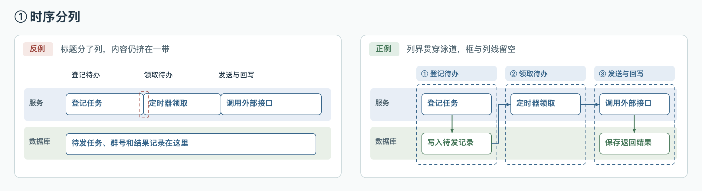
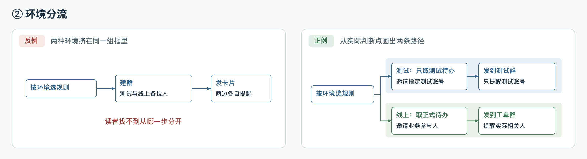
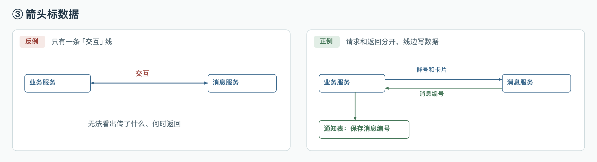
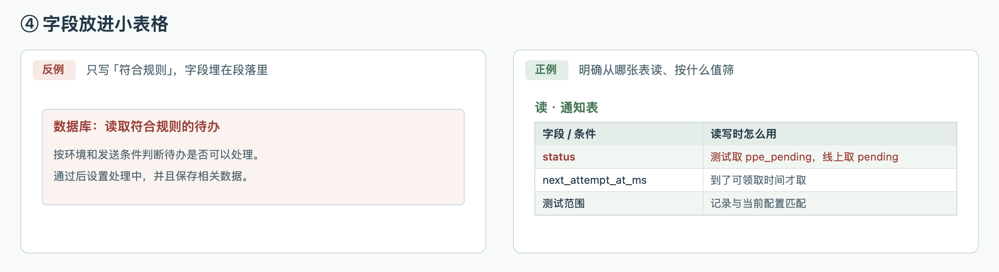
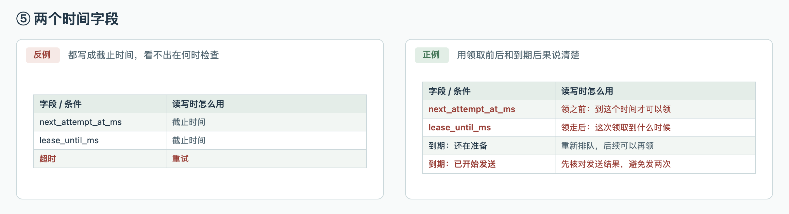
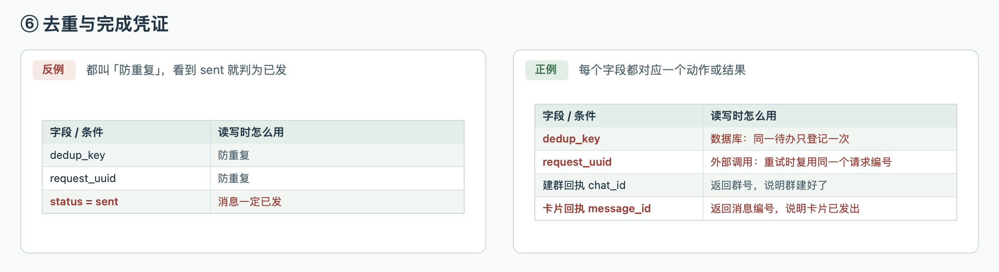
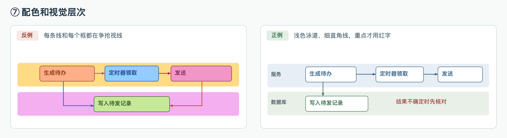
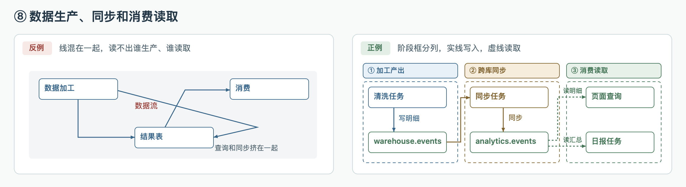
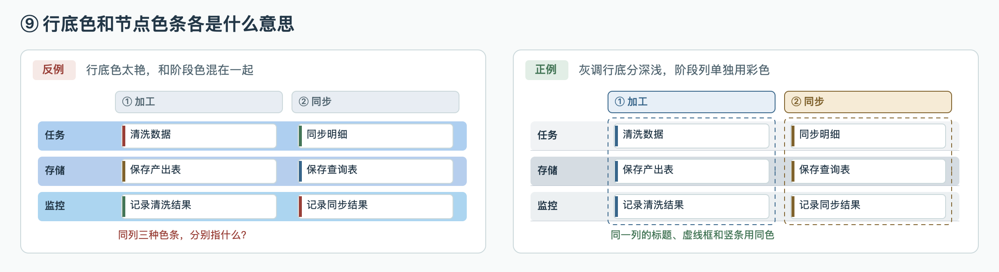

# 系统泳道图的正例与反例

这些例子来自一张通知系统泳道图的多轮修改。把具体业务、账号和工单信息去掉，保留能迁移到导入、发布、审核、异步任务等系统的画法。

## 1. 一眼能看出时间从哪里往哪里走

**反例。** 上方写了四个阶段，下面仍是整条连续的色带，其中一个配置框横跨三个阶段。第二列的节点几乎贴着列线。

**正例。** 横向排「登记待办 → 定时器领取 → 建群或沿用原群 → 检查并发送」，列间留白贯穿所有泳道。需要进一步强调时，每个阶段加一圈细虚线。节点留足内边距，把配置放到它实际影响的阶段。

**为什么。** 读者能按列扫过系统动作。跨列箭头表示推进到了下一步，同列的竖向箭头表示系统间传数据。节点贴边时，读者容易把框线和列线看成一条线。

## 2. 让分叉点和两条链路都看得见

**反例。** 在每个动作框里各写一段「测试」「线上」，两边共用一条主箭头。或者只用颜色区分，图里找不到谁做了分流判断。

**正例。** 把分流判断画在发生的位置。通知案例中，定时器先看运行环境和发送规则，再分两条线领取测试或正式待办。分叉后按同样的三列对齐：

| 路径 | 拉谁进群 | 发前查什么 | 最后提醒谁 |
| --- | --- | --- | --- |
| 测试 | 只邀请指定测试账号 | 核对群号、测试设置和群成员 | 发到测试群，只提醒测试账号 |
| 线上 | 邀请工单的真实参与人 | 确认提醒仍有效，按需补邀 | 发到工单群，按业务动作提醒相关人 |

**为什么。** 两条线从同一个判断点出发，读者可以从头跟到底，也能逐列比较。如果两边共用外部接口，在接口旁明确写「共用」，并标请求和返回。

## 3. 箭头写数据，框里写动作

**反例。** 一条双向线连着「业务服务」和「飞书」，线旁写「交互」，框里塞了建群、查人、发消息和保存回执的整段说明。

**正例。** 分开标「成员名单 → 建群接口」和「群号 → 业务服务」。另画「群号和卡片 → 发消息接口」及「消息编号 → 业务服务」，最后从服务画箭头回通知表，标「保存消息编号」。

**为什么。** 箭头让读者看清是谁在什么时候拿到什么数据。例如群号要先返回，服务才能绑定群并用它发卡片。有不同数据的请求和返回走独立直角线，比一条统称「交互」的线更容易查顺序。

## 4. 关键字段写进图，读写各放一张小表

**反例。** 只写「查数据库」「符合测试设置」或「保存结果」，把具体字段留到聊天里解释。也有一种画法把表名、字段、条件全挤在段落里，结果无法快速对照。

**正例。** 数据库泳道左侧写真实表名。在阶段内部把「登记时写」「领取时读」「成功后更新」分开。领取表可以这样写：

| 字段 | 怎么筛 |
| --- | --- |
| `status` | 测试取 `ppe_pending`，线上取 `pending` |
| `next_attempt_at_ms` | 到了最早可领取时间才取 |
| 测试范围字段 | 已写进通知的环境、站点等设置要与当前配置匹配 |

**为什么。** 读者能直接从图里找出「哪张表、哪个字段、拿什么值判断」。对「同配置」这类简称，说明两边各拿什么比较。字段名和状态值从当前系统核对；另一系统可能使用完全不同的名字。

## 5. 容易混淆的字段，贴在各自生效的位置解释

**反例。** 把 `next_attempt_at_ms` 和 `lease_until_ms` 都叫「截止时间」，或者只写「加锁防重复」。

**正例。** 在「读 · 取待办」小表标「可领取时间：领之前看」。在「写 · 领走后」小表标「锁的截止时间：领走后看，这次领取什么时候失效」。领取编号旁写「写结果时核对，防止旧实例覆盖新结果」。下方两行用红字写出到期后的分支：还在准备就重新排队，已进入发送就先核对结果。

**为什么。** 两个时间都用于控制处理节奏，但一个决定能否开始，另一个决定这次领取是否仍有效。到期分支说明接下来会发生什么，也说明为什么某些情况不能直接重发。超时长度和重试规则按事实写。

## 6. 去重和成功凭证要说到具体副作用

**反例。** 给 `dedup_key` 和 `request_uuid` 都写「防重复」。看到 `sent` 就在图上标「消息已发」。

**正例。**

| 放在哪一步 | 写给读者看的说明 |
| --- | --- |
| 记待办 | `dedup_key`：同一待办在数据库只记一次 |
| 调外部接口 | `request_uuid`：同一待办重试沿用此编号，让外部系统识别重复请求 |
| 建群回写 | 建群任务完成，回执有 `chat_id`，证明拿到了群号 |
| 发卡片回写 | 卡片发送成功，回执有 `message_id`，证明拿到了这张卡片的消息编号 |

**为什么。** 一处防重复写本地记录，一处让外部系统识别重试。完成状态可能被多种任务共用，只有结合记录类型和对应回执，才能说清哪一个动作办完了。外部接口是否支持去重、支持多久，也要按真实契约表述。

## 7. 配色服务于读图，改图按用户指出的地方走

**反例。** 行背景、阶段框、路径和文字都用醒目的色块，或者为了让颜色更鲜艳而加粗所有线。用户只问「哪里分开」，图里还保留已经不想看的事故复盘。

**正例。** 用参考图那样的浅色横泳道、近白动作框和细直角箭头。用颜色区分主分支，列标题和留白让时序可见。红字留给少数会影响判断的字段或规则。用户要求局部修改时，在原位置修，保留已经确认的内容。

**为什么。** 不同视觉元素各担一件事，读者在正常阅读尺寸能追箭头，放大还能按小表核字段。用户说「挨着边」，应检查框到列线的实测间距；说「看不出分开」，应检查有没有画真正的分叉；说「这些是什么」，应在对应框里补用途。改完先看全图，再放大问题区域核对。

## 8. 数据血缘图里区分生产、同步与消费读取

**反例。** 把加工、写表、同步、查询都画成同样的实线，多个箭头跨列穿过节点。顶部标题用同一种颜色，最后一列同时放同步任务、目标表和所有读取方。即使框里有表名，也难跟出某张表是谁生产、谁消费。

**正例。** 用「① 加工产出 → ② 跨库同步 → ③ 读取使用」分列。每列用不同颜色的标题与同色细虚线外框。数据节点把真实表名加粗。实线按顺序连生产任务、产出表和同步目标表，虚线从目标表指向读取者。共用数据分叉时，在箭头上分别写用途，长线从预留区域绕开正文。

**为什么。** 读者可以先顺着实线追到数据落在哪里，再顺着虚线找谁读取。同一张表服务多个场景时，分叉能说明哪些步骤共用，哪些是各自的用途。颜色帮读者定位阶段，线型帮读者识别动作，表名帮读者回到证据。

## 9. 行底色认系统，框边色条认阶段

**反例。** 大面积行背景用了几种饱和度较高、明暗相近的颜色，和阶段列的颜色混在一起。各个动作框左边又随意放了不同颜色的竖条，导航和图例都没说它们代表什么。

**正例。** 用同一组低饱和灰调做行底，拉开相邻行的明暗差，必要时加轻分隔线。阶段列使用更鲜明的颜色，同一列的标题、虚线外框和节点左侧竖条用同色。图上说明「行底色看系统，框左色条看阶段」，不需要色条时直接省略。

**为什么。** 同色系也可以用明暗分开泳道。把更鲜明的色相留给阶段，读者横着看系统、竖着看阶段时，可以用两套线索定位。缩放后如果看不出行界，拉开行底色的明暗差，再看文字和走线是否依然清楚。
